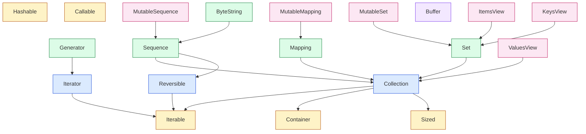

# Section 05: collections.abc — Map of Content

*The ABC hierarchy the standard library uses for `isinstance` checks. `Iterable`, `Sequence`, `Mapping`, `Set`, `Hashable`, `Callable`, `Iterator`, `Generator`, `Buffer` (3.12) — every concrete container in Section 04 is registered as one or more of these. This section walks the tree, the mixin methods each ABC provides, and the `Protocol` vs ABC trade-off.*

**You're at the very beginning of Section 05.**

Where Section 04 taught the *concrete* containers (`Counter`, `deque`, `ChainMap`), Section 05 teaches the *abstract base classes* those containers conform to. `deque` is a `Sequence` and a `MutableSequence`. `Counter` is a `Counter`-shaped `Mapping`. `ChainMap` is a `Mapping`. The ABC hierarchy is the type system the rest of the standard library — `dataclasses`, `itertools`, `functools`, `inspect` — uses to ask "is this thing iterable? hashable? sized? a sequence?".

#collections-abc #moc

## What's in this section

| Lesson | What you learn | Canonical? |
|---|---|---|
| [[05-collections-abc/01-The-ABC-Hierarchy]] | The full tree: `Iterable`→`Iterator`→`Generator`; `Container`, `Hashable`, `Sized`; `Collection` (3.6+); `Sequence`/`MutableSequence`; `Mapping`/`MutableMapping`; `Set`/`MutableSet`; `Buffer` (3.12) | Yes |
| [[05-collections-abc/02-Sequence-Mapping-Set]] | The mixin methods each ABC provides — implement `__getitem__` + `__len__` and `Sequence` gives you `__contains__`, `__iter__`, `__reversed__`, `index`, `count` for free | No |
| [[05-collections-abc/03-Hashable-and-Frozen]] | `Hashable` ABC, `__hash__`, the mutable-vs-immutable contract, why mutable objects are unhashable, the `frozen=True` dataclass connection | No |
| [[05-collections-abc/04-Iterator-vs-Iterable]] | `Iterable.__iter__` vs `Iterator.__next__`, the `iter()` builtin, the StopIteration protocol, the "iterator is exhausted" gotcha | No |
| [[05-collections-abc/05-Custom-ABCs]] | Defining your own ABC with `ABCMeta` + `@abstractmethod`, the `register()` virtual-subclass mechanism, the `__subclasshook__` pattern `collections.abc` uses | No |
| [[05-collections-abc/06-abcs-vs-protocols]] | `collections.abc.Iterable` vs `typing.Protocol` with `__iter__`. Nominal ABCs (register) vs structural protocols (runtime_checkable). When each wins. | Yes |

## The ABC hierarchy diagram

This is the tree the rest of the section walks. Every box is an ABC in `collections.abc`. Arrows mean "subclass of".

**Five root ABCs** — `Iterable`, `Container`, `Sized`, `Hashable`, `Callable`. Everything else is a subclass of one or more of these.

**`Collection` (3.6+)** — the union of `Iterable` + `Container` + `Sized`. If you implement `__iter__`, `__contains__`, and `__len__`, your class is a `Collection`.

**`Buffer` (3.12)** — added by PEP 688 for the buffer protocol (the thing `memoryview` and `bytes` and `bytearray` and `numpy` arrays all support). It has no methods on the ABC itself; it is a registration marker. Note that `Buffer` does not descend from any of the five root ABCs — it is its own root.

**`Sequence` / `MutableSequence`** — the answer to "is this indexable?". `Sequence` mixes in `Reversible` (so `reversed(x)` works) on top of `Collection`. `MutableSequence` adds the write-side (`__setitem__`, `__delitem__`, `insert`, `append`, `extend`, `pop`, `remove`, `__iadd__`).

**`Mapping` / `MutableMapping`** — the answer to "is this dict-like?". `Mapping` provides `keys`, `values`, `items`, `get`, `__contains__`, `__eq__`, `__ne__` as mixins once you implement `__getitem__`, `__iter__`, `__len__`.

**`Set` / `MutableSet`** — the answer to "is this set-like?". Provides `__le__`, `__lt__`, `__gt__`, `__and__`, `__or__`, `__sub__`, `__xor__`, `isdisjoint` as mixins.

**The dict views** — `dict.keys()` returns a `dict_keys` object that conforms to `KeysView` (which extends `Set`); `dict.items()` returns a `dict_items` object that conforms to `ItemsView` (which also extends `Set`); `dict.values()` returns a `dict_values` object that conforms to `ValuesView` (which extends `Collection` — *not* `Set` or `Mapping`, because dict values may repeat or be unhashable). The C-level `dict_keys` / `dict_items` / `dict_values` types are registered as virtual subclasses of the corresponding ABCs, so `isinstance(d.keys(), KeysView)` is `True` even though `dict_keys` does not inherit from `KeysView` in the MRO sense. The `ItemsView` and `KeysView` ABCs in `collections.abc` are *not* subclasses of `Mapping` despite what some documentation summaries suggest — check the source: `ItemsView(MappingView, Set)` and `KeysView(MappingView, Set)`.

## How to read this section

Read [[05-collections-abc/01-The-ABC-Hierarchy]] first — it is the canonical lesson and the map of the whole tree. Then read in numbered order. Lesson 06 (`abcs-vs-protocols`) is the closing canonical and the lesson that decides "do I use an ABC or a `typing.Protocol` for my new type?"

If you only have time for two: read `01-The-ABC-Hierarchy` (the map) and `06-abcs-vs-protocols` (the decision). The middle four are the depth on each subtree.

## Section learning objectives

By the end of Section 05 you will be able to:

1. **Draw the ABC hierarchy from memory** — the five root ABCs, the three collection-tier ABCs, the two-tier mutable-immutable split.
2. **Predict the mixin methods** an ABC gives you for free when you implement its abstract methods.
3. **Implement a custom `Sequence`** in 30 lines that gets `__contains__`, `__iter__`, `__reversed__`, `index`, `count` from the ABC's mixin methods.
4. **Decide between `collections.abc.Iterable` and `typing.Protocol[Iterable]`** for a new function signature, and defend the choice.

## What's next

Open [[05-collections-abc/01-The-ABC-Hierarchy]] — the full tree, walked from the five roots down to the mutable leaves.

## Sources

- **Python `collections.abc` documentation** — https://docs.python.org/3/library/collections.abc.html — accessed 2026-10-23 — the canonical reference for the entire hierarchy, including the `Buffer` ABC added in 3.12.
- **PEP 3119 — Introducing Abstract Base Classes** — https://peps.python.org/pep-3119/ — accessed 2026-10-23 — the original ABC PEP; the design rationale for the hierarchy.

## What we learned in this section

- You opened the MOC. **That is the first step.**
