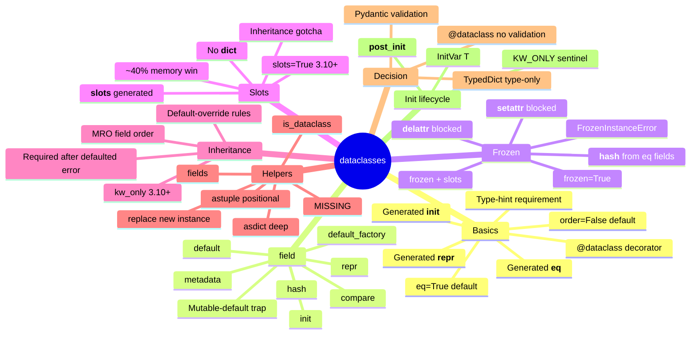

# dataclasses — Section Map of Content

*The standard-library module that auto-writes `__init__`, `__repr__`, and `__eq__` for every model in `boardly` — and the older, faster, validation-free sibling of Pydantic's `BaseModel`.*

**You're at the very beginning of Section 06.**

`dataclasses` is the quiet workhorse of every modern Python backend. When you write `@dataclass` above `class Project:`, Python generates six methods you would otherwise type by hand — `__init__`, `__repr__`, `__eq__`, `__hash__` (sometimes), `__setattr__` and `__delattr__` (only when frozen), and `__match_args__` for structural pattern matching. It is the precursor to Pydantic. It is what SQLAlchemy's `Mapped` data classes, msgspec's structs, and attrs all mimic. And unlike Pydantic, it does zero validation at runtime — which is exactly why it is fast and exactly why it is the wrong tool for parsing an HTTP body. This section teaches both halves of that decision.

#dataclasses #moc #foundation

## Why this section exists

Every senior backend engineer hits a fork in the road: do I model this thing as a `@dataclass`, a `pydantic.BaseModel`, or a `TypedDict`? The three look superficially similar — all three are typed, all three support defaults, all three produce instances you can pass around — but they are not interchangeable. The `@dataclass` is the fastest, the `BaseModel` is the safest, and the `TypedDict` is the cheapest (zero runtime cost, zero instances, just a static hint for a `dict`). Choose wrong and you either spend microseconds you did not need to spend (Pydantic where a `@dataclass` would do) or ship a route that accepts `email="not-an-email"` without complaint (a `@dataclass` where Pydantic was required).

This section gives you the mental model to make that call correctly. We start with `@dataclass` basics — what `init=True`, `repr=True`, `eq=True`, `order=False` actually generate — and walk through `field()`, `frozen=True`, `slots=True`, inheritance, `asdict`/`astuple`/`replace`, and the `KW_ONLY` + `InitVar` lifecycle. The closing comparison lesson is the one most students revisit: it is the senior decision, committed to print.

## The lessons

| # | Lesson | One-sentence summary |
|---|--------|----------------------|
| 01 | [[06-dataclasses/01-dataclass-Basics]] | `@dataclass`, the generated `__init__`/`__repr__`/`__eq__`, the `eq=True`/`order=False` default, the type-hint requirement, and `field()` vs `= value` for defaults. |
| 02 | [[06-dataclasses/02-field-and-Defaults]] | `field(default_factory=list)`, `init`/`repr`/`compare`/`hash`/`metadata`, the mutable-default trap (`[]` is forbidden), and the FastAPI `Field` parallel. |
| 03 | [[06-dataclasses/03-Frozen-and-Immutability]] | `@dataclass(frozen=True)`, the generated `__hash__`, why frozen implies hashable, `frozen` + `slots` interaction, and `FrozenInstanceError`. |
| 04 | [[06-dataclasses/04-Slots-and-Performance]] | `@dataclass(slots=True)` (3.10+), the `__slots__` generation, the ~40% memory win, the no-`__dict__` consequence, the inheritance-with-slots gotcha. |
| 05 | [[06-dataclasses/05-Inheritance]] | Fields accumulate in MRO order, default-override rules, and the `kw_only=True` (3.10+) fix to the "required field after a defaulted one" `TypeError`. |
| 06 | [[06-dataclasses/06-asdict-astuple-replace]] | `asdict(obj)` is deep, `astuple(obj)` is positional, `replace(obj, field=value)` returns a new instance, and the `asdict` deep-copy gotcha. |
| 07 | [[06-dataclasses/07-dataclass-vs-pydantic-vs-typeddict]] | The senior decision: `@dataclass` (fastest, no validation), Pydantic `BaseModel` (validation, slower), `TypedDict` (type-only, no runtime). When each wins. |
| 08 | [[06-dataclasses/08-KW_ONLY-and-InitVar]] | `KW_ONLY` sentinel (3.10+), `InitVar[T]` for init-only fields passed to `__post_init__`, and the full `__post_init__` lifecycle. |

## Mindmap

## Reading order

Read the lessons in numbered order. Lessons 01 and 02 are the canonical foundations — every later lesson assumes you have read them. Lesson 03 (`frozen`) and lesson 04 (`slots`) are independent of each other but both build on the field vocabulary from lesson 02. Lesson 05 (inheritance) needs the `kw_only` introduction from lessons 03 and 04. Lessons 06 and 08 are utilities and lifecycle — read them after 01–05 so the helpers make sense. Lesson 07 (the comparison) is the section closer — it is the lesson most engineers return to, and it is deliberately last because the decision it commits to requires everything before it.

If you only have time for three lessons, read 01, 02, and 07. Those three are enough to use `@dataclass` correctly in a FastAPI project and to know when not to.

## Concepts first-taught in this section

These concepts have their canonical lesson in `06-dataclasses/`:

- **`@dataclass`** → [[06-dataclasses/01-dataclass-Basics]] — the canonical lesson for the decorator itself.
- **`dataclasses.field`** → [[06-dataclasses/02-field-and-Defaults]] — the canonical lesson for per-field configuration.
- **`dataclass` vs Pydantic vs `TypedDict`** → [[06-dataclasses/07-dataclass-vs-pydantic-vs-typeddict]] — the canonical decision lesson.

## Prerequisites

- **Type hints** — [[01-typing/01-Type-Hints-Basics]]. `@dataclass` refuses to generate code for fields without annotations (`name: str` works; `name = "x"` alone does not).
- **`Annotated`** — [[01-typing/02-Annotated-and-Metadata]] is recommended before lesson 02 because `field(metadata=...)` parallels `Annotated[T, metadata]` and the FastAPI `Field` parallel depends on it.

## What you will be able to do by the end

- Read `@dataclass(frozen=True, slots=True)` and predict exactly which six methods Python generates.
- Explain why `tags: list[str] = []` is forbidden and `tags: list[str] = field(default_factory=list)` is required — and name the Python mechanism that enforces it.
- Choose between `@dataclass`, `pydantic.BaseModel`, and `TypedDict` for any given JSON shape and defend the choice.
- Debug a `FrozenInstanceError` and a "non-default argument follows default argument" `TypeError` without searching.
- Read CPython's `dataclasses.py` and not get lost — by the end you will have seen every internal hook the module exposes.

## What's next

When you finish this section, [[07-itertools/00-itertools-MOC]] is the natural next stop if you want to keep going through the standard library; but the more important jump, if you came here from a FastAPI project, is back to [[01-typing/02-Annotated-and-Metadata]] to see how Pydantic's `Field(default_factory=...)` mirrors `dataclasses.field(default_factory=...)` — the two APIs are siblings, and the comparison is the bridge between the modules. Open [[06-dataclasses/01-dataclass-Basics]] to begin.

**Welcome to dataclasses. We'll see you at the end.**

## Sources

- **`dataclasses` — Support for data classes** — https://docs.python.org/3/library/dataclasses.html — accessed 2026-10-23 — the canonical CPython reference for every API in this section.
- **PEP 557 — Data Classes** — https://peps.python.org/pep-0557/ — accessed 2026-10-23 — the original PEP that introduced `@dataclass`; the rationale section is still the best explanation of the module's design.
