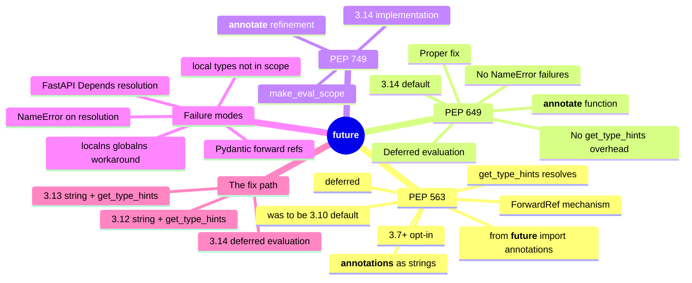

# __future__ — Section Map of Content

*The `from __future__ import annotations` saga — PEP 563 (string annotations, the 3.10+ opt-in), PEP 649 (deferred evaluation, the 3.14 default), PEP 749 (the 3.14 implementation refinement), and the failure modes that break FastAPI and Pydantic at runtime.*

**You're at the very beginning of Section 13.**

`from __future__ import annotations` is one line at the top of a file. It changes the Python runtime in a way that breaks Pydantic models, breaks FastAPI dependency resolution, breaks `dataclasses` with `ClassVar`s, breaks `typing.get_type_hints()` when a name is out of scope, and breaks dozens of other things that read `__annotations__` expecting live types and finding strings instead. And yet, every modern codebase adds the line — because the same feature unlocks forward references, generic-class self-references, and type aliases that reference names defined later in the same module. The saga of how this came to be is the saga of three PEPs (563, 649, 749) and a six-year delay between "we know this is broken" and "we shipped the proper fix". This section tells the saga, version-gates everything by Python version, and teaches you the failure modes so you can debug them in production.

#__future__ #moc #typing

## Why this section exists

If you have ever written `from __future__ import annotations` at the top of a FastAPI route file and had a `pydantic.BaseModel` silently break with a `NameError` on a forward reference — or had `Annotated[int, Depends(get_db)]` fail to resolve because `Depends` was imported inside a function and the string annotation can no longer see it — this section is for you. If you have ever wondered why `typing.get_type_hints(func, include_extras=True)` is what FastAPI calls on every request, and what would happen if it returned strings instead of types — this section is for you. You are in good company. Every senior backend engineer was once exactly here, staring at a `NameError` on a perfectly valid-looking model, with no idea that the line at the top of the file was the cause.

The three lessons walk the mechanism, the saga, and the failure modes. Lesson 01 is the canonical lesson on PEP 563 — what `from __future__ import annotations` does at the bytecode level, why FastAPI needs `get_type_hints()`, and the `ForwardRef` mechanism that resolves strings to types. Lesson 02 is the canonical lesson on the saga — PEP 563 (3.7+ opt-in, was scheduled to be 3.10 default then deferred), PEP 649 (deferred evaluation, default in 3.14), PEP 749 (the 3.14 implementation using `__annotate__`). Lesson 03 is the failure-mode deep dive — `NameError`, the `localns`/`globalns` workaround, why you cannot use local types in annotations, and how FastAPI resolves `Annotated[int, Depends(...)]` despite all of this.

## The lessons

| # | Lesson | One-sentence summary |
|---|--------|----------------------|
| 01 | [[13-future/01-from-future-import-annotations]] | `from __future__ import annotations` (PEP 563) stores all annotations as strings in `__annotations__`; `get_type_hints()` resolves them at call time; the `ForwardRef` mechanism. |
| 02 | [[13-future/02-PEP-563-vs-PEP-649-vs-PEP-749]] | The saga: PEP 563 (3.7+ opt-in), PEP 649 (deferred evaluation, 3.14 default), PEP 749 (3.14 `__annotate__` implementation). Why PEP 649 is the proper fix. |
| 03 | [[13-future/03-When-string-annotations-break]] | The failure modes: `NameError` on `get_type_hints()`, the `localns`/`globalns` workaround, the FastAPI `Annotated[int, Depends(...)]` resolution path, the "no local types in annotations" rule. |

## Mindmap

## Reading order

Read the lessons in numbered order. Lesson 01 is the foundation — every later lesson assumes you understand what `from __future__ import annotations` does at the bytecode level. Lesson 02 (the saga) needs lesson 01's mechanism to explain why PEP 649 is the proper fix. Lesson 03 (failure modes) needs both — the failure modes are the direct consequence of the PEP 563 string-storage behaviour, and the PEP 649 / 749 fix is the resolution. The three lessons are short (each ~30 minutes) but dense — re-read lesson 01 after lesson 03 to consolidate.

## Concepts first-taught in this section

These concepts have their canonical lesson in `13-future/`:

- **`from __future__ import annotations`** → [[13-future/01-from-future-import-annotations]] — the canonical lesson for PEP 563.
- **PEP 649 vs PEP 563** → [[13-future/02-PEP-563-vs-PEP-649-vs-PEP-749]] — the canonical lesson for the saga and the 3.14 default.

## Prerequisites

- **Type hints** — [[01-typing/01-Type-Hints-Basics]]. `__annotations__` is the dict Python populates from type hints.
- **`Annotated`** — [[01-typing/02-Annotated-and-Metadata]]. Lesson 03's failure modes turn on `Annotated[T, metadata]` resolution.
- **`get_type_hints` vs `__annotations__`** — [[01-typing/11-typing-vs-runtime]]. The two APIs and why FastAPI uses `get_type_hints(..., include_extras=True)`.

## What you will be able to do by the end

- Read `from __future__ import annotations` and predict every observable behaviour change at runtime.
- Explain why `get_type_hints()` is required for FastAPI and Pydantic to read annotations on a 3.12 file with `from __future__ import annotations`.
- Diagnose a `NameError: name 'X' is not defined` raised from `get_type_hints()` — name the missing name, find the scope it should be in, and apply the `localns`/`globalns` workaround.
- Explain why you cannot use local types in annotations — and how `PEP 649`'s deferred evaluation (3.14) lifts this restriction.
- Decide whether to put `from __future__ import annotations` at the top of a new file — and what changes in 3.14 when the default flips.

## What's next

When you finish this section, you have completed the typing + runtime tour. [[14-importlib/00-importlib-MOC]] is the natural next stop if you keep going through the standard library. If you came here from a FastAPI debugging session, the natural next stop is [[10-inspect/00-inspect-MOC]] — `inspect.signature` is what FastAPI calls to read a route's parameters, and `inspect`'s interaction with `from __future__ import annotations` is the second half of the story. Open [[13-future/01-from-future-import-annotations]] to begin.

**Welcome to `__future__`. We'll see you at the end.**

## Sources

- **`__future__` — Future statement definitions** — https://docs.python.org/3/library/__future__.html — accessed 2026-10-23 — the canonical reference for every `__future__` import, including `annotations`.
- **`typing.get_type_hints`** — https://docs.python.org/3/library/typing.html#typing.get_type_hints — accessed 2026-10-23 — the function FastAPI calls on every request to resolve string annotations.
- **PEP 563 — Postponed evaluation of annotations** — https://peps.python.org/pep-0563/ — accessed 2026-10-23 — the PEP that introduced `from __future__ import annotations`.
- **PEP 649 — Deferred evaluation of annotations** — https://peps.python.org/pep-0649/ — accessed 2026-10-23 — the PEP that will become the 3.14 default.
- **PEP 749 — Implementation of PEP 649** — https://peps.python.org/pep-0749/ — accessed 2026-10-23 — the 3.14 implementation using `__annotate__`.
