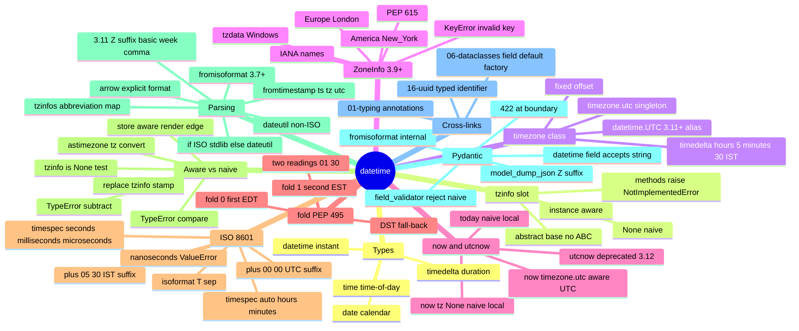

# datetime — Section Map of Content

*The `datetime` type, the `timezone` and `ZoneInfo` timezone classes, the `timedelta` duration type, the ISO 8601 serialisation contract, and the aware-vs-naive distinction that has caused every timezone bug you have ever shipped — the standard-library answer to "what does this wall-clock reading actually mean?".*

**You're at the very beginning of Section 15.**

`datetime` is the standard library's timestamp type. Where `str` is a type for *text* (and so `"2026-10-23T12:00:00"` is a valid `str` field, including when the field is named `created_at`), `datetime.datetime` is a type for *instants* — a fully-specified point in time, with a date, a time-of-day, and (if you set the `tzinfo` slot) a timezone that pins the value to UTC or to a named IANA zone. The module exists because timestamps are not text; they are values that happen to *render* as an ISO 8601 string at the boundary, and storing them as `str` disables every check `datetime` was built to enforce. If your code touches a `created_at`, a `deadline`, an `updated_at`, or any event ordering field, you use `datetime`; if you use `str`, you ship a naive-vs-aware bug that surfaces in production at 3am.

This section gives you the type and the `tzinfo` slot (lesson 01), the `timedelta` arithmetic layer (lesson 02), the ISO 8601 serialisation contract (lesson 03), the aware-vs-naive production rule (lesson 04), and the `fromisoformat` / `zoneinfo` parse boundary (lesson 05). By the end you will know why every timestamp field in a boardly API model is `datetime`, why `created_at` defaults to `datetime.now(timezone.utc)` (never `datetime.now()`), why `datetime.utcnow()` is deprecated in 3.12, why comparing a naive `datetime` to an aware one raises `TypeError`, and why the rule "store aware UTC, render in the user's timezone at the edge" is non-negotiable.

#datetime #moc #foundation

## Why this section exists

Every senior backend engineer hits the naive datetime bug at least once. You write `created_at = datetime.now()` and store the value, and it works — until the day your service moves from a London data centre to a Tokyo one and every `created_at` reading jumps nine hours, the audit log stops agreeing with itself, and the SLA calculation drifts by an hour. The fix is not `datetime.utcnow()` (that is *deprecated* in 3.12 and still returns a naive value, the worst form of the bug); the fix is `datetime.now(timezone.utc)` — a one-argument change that pins every value to UTC and makes the storage layer unambiguous. The whole module is one sentence: "store aware UTC, render in the user's timezone at the edge, never let a naive `datetime` past the parse boundary".

But the section does not stop there. The `datetime` module exposes four sibling types (`datetime`, `date`, `time`, `timedelta`) and two timezone classes (`timezone` for fixed offsets, `ZoneInfo` for IANA-named zones). Lesson 01 covers the type and the `tzinfo` slot — `datetime(2026, 10, 23, 12, 0, 0, tzinfo=timezone.utc)` for an aware UTC instant, `datetime.tzinfo is None` as the naivety test, the deprecated `utcnow()` and the `datetime.UTC` 3.11+ alias. Lesson 02 walks `timedelta` — the seven-argument constructor (`weeks`, `days`, `hours`, `minutes`, `seconds`, `milliseconds`, `microseconds`), the normalisation into `days`/`seconds`/`microseconds` that catches every "off by a week" bug, and the `//` floor-division that lets you count "how many hours apart are these two events". Lesson 03 walks `isoformat()` — the canonical ISO 8601 form `2026-10-23T12:00:00.ffffff+00:00`, the `timespec` parameter that controls precision, the `sep` parameter that toggles `T` vs space, and the round-trip with `fromisoformat()`. Lesson 04 is the production bug lesson — the `TypeError: can't compare offset-naive and offset-aware datetimes` exception that catches the naive-vs-aware bug at the comparison layer, the `astimezone(tz)` conversion, the `fold` attribute (PEP 495) for DST disambiguation, and the cardinal rule. Lesson 05 walks the parse boundary — `fromisoformat(s)` (Python 3.7+; 3.11+ extended to handle the `Z` suffix, basic format, week dates, the comma decimal separator — version-gated), `fromtimestamp(ts, tz=...)` for POSIX-timestamp ingestion, `zoneinfo.ZoneInfo(key)` (Python 3.9+, PEP 615) for IANA timezone names, and the `dateutil` / `arrow` third-party fallback for non-ISO formats.

## The lessons

| # | Lesson | One-sentence summary |
|---|--------|----------------------|
| 01 | [[15-datetime/01-datetime-and-timezone]] | `datetime(2026, 10, 23, 12, 0, 0, tzinfo=timezone.utc)` for an aware UTC instant, the four sibling types (`datetime` / `date` / `time` / `timedelta`), the `tzinfo` abstract base vs the `timezone` concrete fixed-offset subclass vs `timezone.utc` singleton, the keyword-only `fold` argument (PEP 495, 3.6+), `datetime.now(tz=None)` (naive local — don't) vs `datetime.now(timezone.utc)` (aware UTC — do), the `datetime.UTC` 3.11+ alias, and the deprecated `utcnow()` (3.12). |
| 02 | [[15-datetime/02-timedelta]] | `timedelta(weeks=1, days=2, hours=3, minutes=4, seconds=5, milliseconds=6, microseconds=7)` (the seven-argument constructor, normalised into `days`/`seconds`/`microseconds` internally — there is no `.hours` or `.minutes` attribute), `dt + timedelta(hours=1)` and `dt1 - dt2` arithmetic, `.total_seconds()` (returns a `float`, not an `int`), and the `//` floor-division and `%` modulo for "how many hours apart" and "what is the remainder". |
| 03 | [[15-datetime/03-ISO-8601-format]] | `dt.isoformat(sep='T', timespec='auto')` for the canonical ISO 8601 form `2026-10-23T12:00:00.ffffff+00:00`, the six `timespec` options (`auto`/`hours`/`minutes`/`seconds`/`milliseconds`/`microseconds`; `'nanoseconds'` raises `ValueError` — there is no nanosecond precision in `datetime`), the `sep='T'` vs `sep=' '` (machine-to-machine vs human-readable) toggle, the `+00:00` offset suffix that distinguishes aware UTC from naive, and the round-trip with `datetime.fromisoformat(s)`. |
| 04 | [[15-datetime/04-timezone-aware-vs-naive]] | The `dt.tzinfo is None` test for naivety, the `TypeError: can't compare offset-naive and offset-aware datetimes` exception (the production-saver that catches the bug at the comparison layer), `dt.astimezone(tz)` for timezone conversion (preserving the instant — `dt == dt.astimezone(tz)` is `True`), the `replace(tzinfo=...)` stamping vs `astimezone(tz)` conversion distinction, the DST `fold` attribute (PEP 495) for fall-back disambiguation, and the cardinal rule: store aware UTC, render in the user's timezone at the edge, never let a naive `datetime` past the parse boundary. |
| 05 | [[15-datetime/05-fromisoformat-and-parsing]] | `datetime.fromisoformat(s)` (Python 3.7+; 3.11+ extended to handle the `Z` suffix, basic format, week dates, the comma decimal separator, single-digit-hour offsets — version-gated), `datetime.fromtimestamp(ts, tz=timezone.utc)` for POSIX-timestamp ingestion (always pass `tz=timezone.utc`), `zoneinfo.ZoneInfo(key)` (Python 3.9+, PEP 615) for IANA-named timezones (`ZoneInfo("America/New_York")`), the `dateutil` / `arrow` third-party fallback for non-ISO formats (with the `tzinfos` argument for abbreviation disambiguation), the "if ISO, use stdlib; otherwise use dateutil" rule, and the Pydantic `field_validator` that rejects naive input with a 422 at the parse boundary. |

## Mindmap

## Reading order

Read the lessons in numbered order. Lesson 01 is the canonical foundation — the `datetime` type, the `tzinfo` slot, the `timezone.utc` singleton, and the `datetime.now(timezone.utc)` rule. Every later lesson and every cross-link in the vault assumes you have internalised "store aware UTC, never `datetime.now()`". Lesson 02 (`timedelta`) builds on lesson 01 — the arithmetic layer only makes sense once the type is committed, and the `tzinfo` preservation rule (an aware `datetime` plus a `timedelta` is still aware) is what makes the SLA arithmetic safe. Lesson 03 (`isoformat`) builds on lesson 02 — the serialise side depends on the type and the arithmetic producing values worth serialising. Lesson 04 (aware vs naive) is the production bug lesson — it depends on lessons 01–03 because the `TypeError` is the type system's enforcement of the contract lesson 01 stated and lesson 03 serialised. Lesson 05 (`fromisoformat`) builds on lesson 04 — the parse boundary is where naive values slip in, and lesson 04's rule "never let a naive `datetime` past the parse boundary" is what lesson 05 enforces with a Pydantic `field_validator`.

If you only have time for one lesson, read lesson 01. It is enough to stop shipping the naive datetime bug; the `timedelta` arithmetic, the ISO 8601 serialisation, the `TypeError` exception, and the `fromisoformat` parsing are refinements you can pick up later when a specific bug forces the question.

If you have time for two, read 01 and 04 — you will know why `datetime.now(timezone.utc)` is the only `now()` call you should make, why `datetime.utcnow()` is deprecated, and why the `TypeError: can't compare offset-naive and offset-aware datetimes` exception is your friend. The other three lessons (timedelta arithmetic, ISO 8601 serialisation, `fromisoformat` parsing) are the supporting machinery.

If you have time for all five, you will know the entire `datetime` surface the section covers — enough to design a timestamp field, an SLA computation, an API serialisation contract, and a parse boundary without surprises.

## Concepts first-taught in this section

These concepts have their canonical lesson in `15-datetime/`:

- **`datetime` and the `tzinfo` slot** → [[15-datetime/01-datetime-and-timezone]] — the canonical lesson for the `datetime` type, the `tzinfo` slot, the `timezone` concrete fixed-offset class, `timezone.utc`, the `datetime.now(timezone.utc)` rule, and the `datetime.utcnow()` deprecation.
- **`timedelta` and duration arithmetic** → [[15-datetime/02-timedelta]] — the canonical lesson for the `timedelta` type, the seven-argument constructor, the `days`/`seconds`/`microseconds` normalisation, and the `//` and `%` operators.
- **ISO 8601 serialisation** → [[15-datetime/03-ISO-8601-format]] — the canonical lesson for `datetime.isoformat(sep='T', timespec='auto')`, the six `timespec` options, and the round-trip with `fromisoformat`.
- **Aware vs naive and the `TypeError` exception** → [[15-datetime/04-timezone-aware-vs-naive]] — the canonical lesson for the `tzinfo is None` test, the `TypeError: can't compare offset-naive and offset-aware datetimes` exception, `astimezone(tz)`, the `fold` attribute (PEP 495), and the cardinal rule "store aware UTC, render at the edge".
- **`fromisoformat`, `fromtimestamp`, and `zoneinfo`** → [[15-datetime/05-fromisoformat-and-parsing]] — the canonical lesson for the parse boundary: `datetime.fromisoformat(s)` (3.7+; 3.11+ extended — version-gated), `datetime.fromtimestamp(ts, tz=timezone.utc)`, `zoneinfo.ZoneInfo(key)` (3.9+, PEP 615), and the `dateutil` / `arrow` third-party fallback.

## Prerequisites

- **Type hints** — [[01-typing/01-Type-Hints-Basics]]. The `created_at: datetime` annotation on a dataclass or Pydantic model is the field-level contract; you need to be comfortable reading an annotation as a type.
- **A typed model to attach the field to** — [[06-dataclasses/01-dataclass-Basics]]. The section's running example is `boardly`'s `Ticket` and `Project` models with `created_at: datetime` and `deadline: datetime`. The `@dataclass` decorator and the `field(default_factory=...)` pattern are taught in the dataclass lessons; this section assumes you have read them.
- **`field()` and defaults** — [[06-dataclasses/02-field-and-Defaults]] is recommended before lesson 01, because `created_at: datetime = field(default_factory=lambda: datetime.now(timezone.utc))` is the running example and the `default_factory` machinery is what makes the per-instance default work.
- **The `UUID` sibling section** — [[16-uuid/00-uuid-MOC]] is recommended as a paired read. `UUID` and `datetime` are the two "typed value at the boundary" lessons in the stdlib: `UUID` for entity identity (`Project.id: UUID`), `datetime` for event ordering (`Ticket.created_at: datetime`). The two MOCs are designed to be read as a pair so the rule lands twice — `id: UUID` instead of `id: str`, `created_at: datetime` instead of `created_at: str`. The pattern is the same: pick the type that matches the value's structure, parse at the boundary, never let the primitive form survive past the parse.

## What you will be able to do by the end

- Construct an aware UTC `datetime` with `datetime(2026, 10, 23, 12, 0, 0, tzinfo=timezone.utc)` and explain what every constructor argument means — including the keyword-only `fold` (PEP 495, 3.6+).
- Distinguish `date` (calendar date), `time` (time-of-day), `datetime` (an instant), and `timedelta` (a duration) and name which one you reach for at which boundary.
- Explain that `tzinfo` is the abstract base class (instantiable but its methods raise `NotImplementedError` when called) and `timezone` is the concrete fixed-offset subclass; `timezone.utc` is the UTC singleton; `datetime.UTC` (3.11+) is the alias.
- Call `datetime.now(timezone.utc)` for aware UTC and refuse to call `datetime.now()` (naive local) or `datetime.utcnow()` (deprecated in 3.12, naive-UTC-flavoured).
- Construct a `timedelta` with any of the seven keyword arguments and read `.days`, `.seconds`, `.microseconds` directly (knowing that `.hours` and `.minutes` do not exist as attributes).
- Do `datetime + timedelta -> datetime` arithmetic and `datetime - datetime -> timedelta` subtraction, and use `.total_seconds()` (knowing it returns a `float`) and `//` / `%` for floor-division counting.
- Serialise an aware UTC `datetime` with `dt.isoformat()` to `2026-10-23T12:00:00+00:00` and pass `timespec` (`'seconds'`, `'milliseconds'`, `'microseconds'`, etc.) to control precision — and refuse `timespec='nanoseconds'` (raises `ValueError`).
- Read the offset suffix — `+00:00` for UTC, `+05:30` for IST, no suffix for naive — and explain why "no suffix" is the ambiguous case that lesson 04's rule prevents.
- Read `dt.tzinfo is None` to detect a naive `datetime`, trigger and read the `TypeError: can't compare offset-naive and offset-aware datetimes` exception, and use `dt.astimezone(tz)` to convert an aware `datetime` from one timezone to another (preserving the instant).
- Parse ISO 8601 with `datetime.fromisoformat(s)`, explain the Python 3.7+ baseline and the 3.11+ extension (Z suffix, basic format, week dates, comma decimal separator, short offsets), and version-gate the 3.11+ features.
- Ingest POSIX timestamps with `datetime.fromtimestamp(ts, tz=timezone.utc)` (never `tz=None`) and use `zoneinfo.ZoneInfo(key)` (3.9+, PEP 615) for IANA-named timezones.
- Pick the right parser for the format — `fromisoformat` for ISO, `dateutil.parser.parse` for non-ISO with explicit `tzinfos`, never hand-roll a regex parser — and implement a Pydantic `field_validator` that rejects naive `datetime` input with a 422.
- State the cardinal rule: store aware UTC, compare aware UTC, render in the user's timezone at the edge using `astimezone(ZoneInfo(user.timezone))`, and never let a naive `datetime` past the parse boundary.

## What's next

When you finish this section, the natural next stop is [[16-uuid/00-uuid-MOC]] — the closest sibling section in the vault. `UUID` and `datetime` are the two "typed value at the boundary" lessons in the stdlib: `UUID` for entity identity (`Project.id: UUID`), `datetime` for event ordering (`Ticket.created_at: datetime`). The two MOCs are designed to be read as a pair so the rule lands twice — `id: UUID` instead of `id: str`, `created_at: datetime` instead of `created_at: str`. The pattern is the same: pick the type that matches the value's structure, convert at the boundary, never let the primitive form survive past the parse.

For the dataclass arc, the most relevant cross-link is [[06-dataclasses/02-field-and-Defaults]] — the `field(default_factory=...)` pattern that the `Ticket.created_at` field uses to call `datetime.now(timezone.utc)` per-instance, and the surrounding `field()` machinery that makes the default-factory pattern work. Open [[15-datetime/01-datetime-and-timezone]] to begin.

**Welcome to datetime. We'll see you at the end.**

## Sources

- **Python `datetime` module documentation** — https://docs.python.org/3/library/datetime.html — accessed 2026-10-23 — the canonical CPython reference for `datetime`, `date`, `time`, `timedelta`, `tzinfo`, `timezone`, `timezone.utc`, `now(tz=...)`, `utcnow()` (deprecated 3.12), `isoformat(sep, timespec)`, `fromisoformat(s)`, `fromtimestamp(ts, tz=...)`, `astimezone(tz)`, the aware-vs-naive distinction, and the `TypeError` exception.
- **`zoneinfo` — IANA time zone support** — https://docs.python.org/3/library/zoneinfo.html — accessed 2026-10-23 — the `ZoneInfo` class (Python 3.9+, PEP 615) for IANA-named timezones; the IANA database, the `tzdata` package on Windows, and the `KeyError` on invalid keys.
- **PEP 495 — Local Time Disambiguation** — https://peps.python.org/pep-0495/ — accessed 2026-10-23 — the `fold` attribute (Python 3.6+) that disambiguates the two wall-clock readings of a DST fall-back transition; source for lesson 01's `fold` argument and lesson 04's DST fold case.
- **PEP 615 — The `zoneinfo` module** — https://peps.python.org/pep-0615/ — accessed 2026-10-23 — the standard-library `zoneinfo` module backed by the IANA timezone database; the design choice to subclass `tzinfo` and replace `pytz`.
- **`python-dateutil` documentation** — https://dateutil.readthedocs.io/en/stable/parser.html — accessed 2026-10-23 — the `dateutil.parser.parse(s, tzinfos=...)` API for non-ISO formats; the `tzinfos` argument for disambiguating timezone abbreviations like `EST` (US Eastern vs Australian Eastern).
- **`arrow` documentation** — https://arrow.readthedocs.io/en/latest/ — accessed 2026-10-23 — the third-party `arrow` library; the `arrow.get(s, format)` API for explicit-format parsing, and the `Arrow` wrapper around `datetime`.
- **ISO 8601 — Date and time format** — https://www.iso.org/standard/70907.html — accessed 2026-10-23 — the international standard that defines the `YYYY-MM-DDTHH:MM:SS.ffffff+HH:MM` family of formats CPython `isoformat()` produces and `fromisoformat()` parses.
