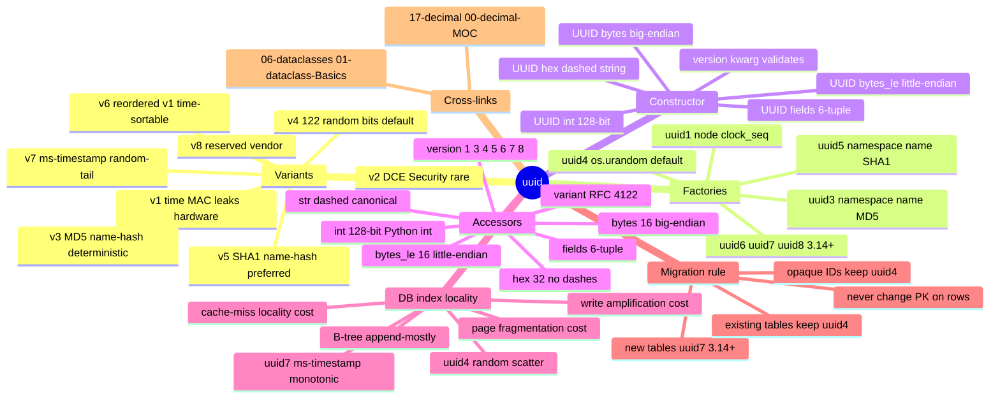

# uuid — Section Map of Content

*The `UUID` class, the four factory functions, the eight RFC 9562 variants, and the never-use-`str`-for-an-identifier rule — the standard-library answer to "why did my B-tree fragment and my IDs accept `"banana"` as a primary key".*

**You're at the very beginning of Section 16.**

`uuid` is the standard library's identifier type. Where `str` is a type for *text* (and so `"banana"` is a valid `str` field, including when the field is named `id`), `uuid.UUID` is a type for *identifiers* — a 128-bit value with a typed representation that validates the layout, exposes the version and variant bits, and rejects malformed input at construction time. The module exists because identifiers are not text; they are values that happen to *render* as a 36-character dashed string at the boundary, and storing them as `str` disables every check `UUID` was built to enforce. If your code touches a primary key, a request ID, a correlation token, or a public-facing identifier, you use `UUID`; if you use `str`, you ship a malformed-input bug that surfaces in production logs at 3am.

This section gives you the type and the eight RFC 9562 variants (lesson 01), and the factory choice — `uuid4` for opaque IDs and `uuid7` (Python 3.14+, version-gated) for database primary keys where index locality matters (lesson 02). By the end you will know why every `id` field in a boardly API model is `UUID`, why `str(uuid)` appears only at the JSON serialisation boundary, and why new tables on 3.14+ use `uuid.uuid7()` for primary keys while existing tables keep `uuid.uuid4()` forever.

#uuid #moc #foundation

## Why this section exists

Every senior backend engineer hits the str-id bug at least once. You write `id: str` on a dataclass, paste a `str(uuid.uuid4())` into it, and ship it, and it works — until the day a column gets wide enough that one in a million requests sends a malformed ID past your validator and you discover that `str` is not a type for identifiers, it is a type for text. The fix is not `isinstance(id, str)` validation (that hides the bug, it does not fix it); the fix is `uuid.UUID`. The whole module is one sentence: "use a 128-bit typed identifier type for identifiers, and stop pretending strings are good enough for primary keys".

But the section does not stop there. The `uuid` module exposes four factory functions (`uuid.uuid1` for time + MAC, `uuid.uuid3` and `uuid.uuid5` for deterministic name-hash derivation, `uuid.uuid4` for random) and a constructor that accepts five mutually-exclusive input forms (hex string, int, bytes, bytes_le, fields tuple). Lesson 01 covers all of it — the variants, the factories, the accessors, and the never-`str` rule. Lesson 02 commits the *factory*: `uuid4` is right for opaque IDs (correlation tokens, request IDs where you do not want timestamp leakage), `uuid7` (Python 3.14+, version-gated) is right for new database primary keys (millisecond-timestamp prefix → monotonically increasing → B-tree append-mostly → index locality). The migration rule is non-negotiable: new tables use `uuid7`; existing tables keep `uuid4` forever, because changing a primary-key value on existing rows invalidates every foreign-key reference and every cached URL.

## The lessons

| # | Lesson | One-sentence summary |
|---|--------|----------------------|
| 01 | [[16-uuid/01-UUID-variants]] | The eight RFC 9562 variants (1: time + MAC, leaks hardware — never public; 2: DCE Security, rare; 3: MD5 name-hash, deterministic, deprecated-in-spirit; 4: 122 random bits, the default; 5: SHA1 name-hash, deterministic, preferred over 3; 6: reordered v1, time-sortable, 3.14+; 7: millisecond timestamp + random tail, 3.14+, the new-DB-PK default; 8: reserved/vendor), the four factory functions (`uuid.uuid1` / `uuid.uuid3(ns, name)` / `uuid.uuid4()` / `uuid.uuid5(ns, name)`), the `UUID(hex=...)` / `UUID(int=...)` / `UUID(bytes=...)` / `UUID(bytes_le=...)` / `UUID(fields=...)` constructor forms, and the `.hex` / `.int` / `.bytes` / `.bytes_le` / `.fields` / `.variant` / `.version` accessors. |
| 02 | [[16-uuid/02-uuid4-vs-uuid7]] | Why `uuid4` is great for uniqueness and terrible for B-tree indexes (page fragmentation, write amplification, cache-miss locality from the 122-bit uniform-random layout); the `uuid7` layout (48-bit millisecond-timestamp prefix + 12-bit `rand_a` + 2-bit variant + 62-bit `rand_b` — monotonically increasing across milliseconds); the migration rule (new tables use `uuid7` on 3.14+; existing tables keep `uuid4` and are never migrated; opaque IDs keep `uuid4` on every runtime, because the `uuid7` timestamp prefix leaks timing information). |

## Mindmap

## Reading order

Read the lessons in numbered order. Lesson 01 is the canonical foundation — the `UUID` type, the five constructor forms, the four factory functions, and the never-`str` rule. Every later lesson and every cross-link in the vault assumes you have internalised "the field is `UUID`, the string form exists only at the boundary". Lesson 02 (uuid4 vs uuid7) builds on lesson 01 — the factory choice only makes sense once the type is committed, and the index-locality argument needs the `.int` accessor and the version-bit layout from lesson 01 in your head.

If you only have time for one lesson, read lesson 01. It is enough to stop shipping the str-id bug; the factory choice in lesson 02 is a refinement you can pick up later when a DBA files an index-fragmentation ticket.

If you have time for two, read both — you will know why `Project.id: UUID` with `default_factory=uuid.uuid4` is right on 3.12 and right on 3.14 for opaque IDs, and why new tables on 3.14+ should switch the `default_factory` to `uuid.uuid7` for the primary-key field specifically.

## Concepts first-taught in this section

These concepts have their canonical lesson in `16-uuid/`:

- **`UUID` and the never-`str` rule** → [[16-uuid/01-UUID-variants]] — the canonical lesson for the `UUID` type, the five constructor forms, the four factory functions, the eight RFC 9562 variants, and the rule that the field type is `UUID` and the string form exists only at the JSON serialisation boundary.
- **`uuid4` vs `uuid7` and the B-tree index-locality trade-off** → [[16-uuid/02-uuid4-vs-uuid7]] — the canonical lesson for the factory choice: `uuid4` for opaque IDs (random, no ordering, no metadata), `uuid7` for new database primary keys (millisecond-timestamp prefix → monotonic → append-mostly), and the migration rule (new tables use `uuid7`; existing tables keep `uuid4`).

## Prerequisites

- **Type hints** — [[01-typing/01-Type-Hints-Basics]]. The `id: UUID` annotation on a dataclass or Pydantic model is the field-level contract; you need to be comfortable reading an annotation as a type.
- **A typed model** — [[06-dataclasses/01-dataclass-Basics]]. The section's running example is `boardly`'s `Project` model with `id: UUID = field(default_factory=uuid.uuid4)`. The `field(default_factory=...)` pattern and the surrounding dataclass machinery are taught in the dataclass lesson; this section assumes you have read it.
- **`Decimal` — the sibling section** — [[17-decimal/00-decimal-MOC]] is recommended as a paired read. `UUID` and `Decimal` are the two "never use the primitive type" lessons in the stdlib: never use `str` for an identifier (use `UUID`), never use `float` for money (use `Decimal`). The two MOCs are designed to be read as a pair so the rule lands twice.

## What you will be able to do by the end

- Construct a `UUID` from a hex string, an int, 16 bytes (big-endian or little-endian), or a 6-field tuple, and explain which external systems hand you which form (Postgres binary, SQL Server `uniqueidentifier`, URL string, integer column).
- Name all eight RFC 9562 variants (1, 2, 3, 4, 5, 6, 7, 8), say what each one is sorted on (time, name, or randomness), and what each one leaks (MAC, nothing, or timestamp).
- Pick the right factory function for a given context: `uuid1` for closed-system debuggability (never public), `uuid3` for legacy MD5-derived deterministic IDs, `uuid4` for the default opaque ID, `uuid5` for the deterministic name-hash (preferred over `uuid3`), `uuid7` (3.14+) for new database primary keys.
- Read the `.hex`, `.int`, `.bytes`, `.bytes_le`, `.fields`, `.variant`, and `.version` accessors and know which one to reach for at which boundary.
- Version-gate `uuid6`/`uuid7`/`uuid8` correctly: `hasattr(uuid, "uuid7")` for runtime feature detection (library code), `sys.version_info >= (3, 14)` for import-time fail-fast (application code).
- Explain why `uuid4` hurts a B-tree primary-key index (page fragmentation, write amplification, cache-miss locality) and why `uuid7`'s millisecond-timestamp prefix produces the append-mostly behaviour that fixes it.
- State the migration rule: new tables use `uuid7` on 3.14+; existing tables keep `uuid4` and are never migrated; opaque IDs (request IDs, correlation tokens) keep `uuid4` on every runtime because the `uuid7` timestamp prefix leaks timing information.
- State the cardinal rule of the section: never store an identifier as `str`. The dataclass field is `UUID`. The string form exists only at the JSON serialisation boundary.

## What's next

When you finish this section, the natural next stop is [[17-decimal/00-decimal-MOC]] — the closest sibling section in the vault. `UUID` and `Decimal` are the two "never use the primitive type" lessons in the stdlib: never use `str` for an identifier (use `UUID`), never use `float` for money (use `Decimal`). The two MOCs are designed to be read as a pair so the rule lands twice — `Decimal("0.10")` instead of `0.1`, `id: UUID` instead of `id: str`. The pattern is the same: pick the type that matches the value's structure, convert at the boundary, never let the primitive form survive past the parse.

For the dataclass arc, the most relevant cross-link is [[06-dataclasses/01-dataclass-Basics]] — the `id: UUID = field(default_factory=uuid.uuid4)` field pattern that the entire section uses, and the surrounding `field()` machinery that makes the default-factory pattern work. Open [[16-uuid/01-UUID-variants]] to begin.

**Welcome to uuid. We'll see you at the end.**

## Sources

- **`uuid` — UUID objects and generators** — https://docs.python.org/3/library/uuid.html — accessed 2026-10-23 — the canonical CPython reference for the `UUID` class, the five constructor forms, the four factory functions (`uuid1`, `uuid3`, `uuid4`, `uuid5`), the standard namespaces (`NAMESPACE_DNS`/`NAMESPACE_URL`/`NAMESPACE_OID`/`NAMESPACE_X500`), and the `bytes`/`bytes_le`/`fields`/`hex`/`int`/`variant`/`version` accessors.
- **RFC 9562 — Universally Unique IDentifiers (UUIDs)** — https://www.rfc-editor.org/rfc/rfc9562.html — accessed 2026-10-23 — the current RFC that obsoletes RFC 4122. Defines the eight variants (1 through 8), the layout bits, the timestamp epoch (15 October 1582), and the §5.7 uuid7 layout (48-bit millisecond timestamp + 12-bit `rand_a` + 62-bit `rand_b`). Source for the migration-rule and index-locality arguments in lesson 02.
- **What's New in Python 3.14 — `uuid`** — https://docs.python.org/3.14/whatsnew/3.14.html — accessed 2026-10-23 — confirms that `uuid.uuid6`, `uuid.uuid7`, and `uuid.uuid8` were added to the standard library in Python 3.14 (they do not exist in 3.12 or 3.13). Source for the version-gate language throughout the section.
- **PostgreSQL — `uuid` data type** — https://www.postgresql.org/docs/current/datatype-uuid.html — accessed 2026-10-23 — documents the 16-byte native `uuid` column type and the B-tree index behaviour that motivates the page-fragmentation and write-amplification arguments in lesson 02.
