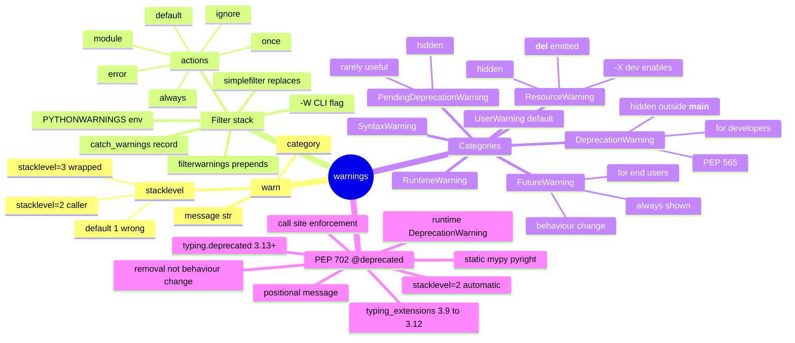

# warnings — Section Map of Content

*The `warn` + `filterwarnings` API, the `DeprecationWarning` vs `FutureWarning` audience distinction (PEP 565), and the `@deprecated` decorator (PEP 702, Python 3.13+; `typing_extensions` backport for 3.12) — the standard-library machinery for telling your users "this will break in a future version" without breaking them now, with both runtime emission and static-typing enforcement.*

**You're at the very beginning of Section 20.**

`warnings.warn("X is deprecated", DeprecationWarning, stacklevel=2)` is one of the most-miswritten one-liners in Python. The `stacklevel=2` is what makes the warning point at the caller — almost every library author forgets it on the first try, ships a warning that points at itself, and the user dismisses it. The `DeprecationWarning` vs `FutureWarning` distinction (PEP 565) is the most under-taught fact in the module: `DeprecationWarning` is for developers of *this* code (hidden by default outside `__main__` since 3.7); `FutureWarning` is for users of the library (always shown). And PEP 702's `@deprecated("use new_func instead")` decorator (Python 3.13+; `typing_extensions` backport for 3.12) closes the gap that pure runtime warnings cannot — the static check that fires at the *call site* during mypy/pyright analysis, in code paths your tests never execute. This section walks the three pieces in order. Take your time. Type every example. **This is how you learn.**

#warnings #moc

## Why this section exists

If you have ever shipped a `warnings.warn("deprecated", DeprecationWarning)` call inside a library function and had a user report "we never saw the warning, our code just broke on upgrade" — this section is for you. If you have ever debated with a teammate whether to use `DeprecationWarning` or `FutureWarning` for a behaviour change and guessed wrong — this section is for you. If you have ever wondered why `typing.deprecated` (PEP 702) is "the static deprecation path the warnings module alone could never give you" — this section is for you. You are in good company. Every senior Python engineer has shipped the wrong `stacklevel`, the wrong category, or the wrong enforcement layer; this section is the corrective.

The three lessons walk the runtime API, the category rule, and the static-typing layer. Lesson 01 is the canonical lesson on `warn` + `filterwarnings` — the `stacklevel=2` rule, the `simplefilter` vs `filterwarnings` distinction, `catch_warnings(record=True)` for tests, and the `-W` / `PYTHONWARNINGS` escape hatches. Lesson 02 is the canonical lesson on the category vocabulary — `DeprecationWarning` vs `FutureWarning` (audience rule, PEP 565), `PendingDeprecationWarning`, `ResourceWarning` (for unclosed files/sockets, enabled with `-X dev`), `SyntaxWarning`, `RuntimeWarning`, and `UserWarning` (the default). Lesson 03 is the canonical lesson on PEP 702 — `@deprecated("...")` on functions and classes, the version-gating (3.13+ for `typing.deprecated`; `typing_extensions` backport for 3.9–3.12), and why the static check at the call site is the new capability the runtime could never give you.

## The lessons

| # | Lesson | One-sentence summary |
|---|--------|----------------------|
| 01 | [[20-warnings/01-warn-and-filterwarnings]] | `warnings.warn(message, category, stacklevel=2)` — `stacklevel=2` is the value you want (the default `1` points at the `warn` line itself, not the caller); the `simplefilter`/`filterwarnings`/`catch_warnings(record=True)` filter stack; the `-W` flag and `PYTHONWARNINGS` env var for CI. |
| 02 | [[20-warnings/02-DeprecationWarning-vs-FutureWarning]] | The category rule: `DeprecationWarning` for "feature will be removed" (audience: developers, hidden by default outside `__main__` per PEP 565); `FutureWarning` for "behaviour will change" (audience: end-users, always shown); plus `PendingDeprecationWarning`, `ResourceWarning`, `SyntaxWarning`, `RuntimeWarning`, `UserWarning`. |
| 03 | [[20-warnings/03-deprecated-decorator-PEP-702]] | `typing.deprecated("use new_func instead")` (Python 3.13+, PEP 702; `typing_extensions.deprecated` backport for 3.9–3.12) — the decorator that emits the runtime `DeprecationWarning` *and* lets mypy/pyright flag the call site statically, derived from one source. |

## Mindmap

## Reading order

Read the lessons in numbered order. Lesson 01 is the foundation — the `warn`, `stacklevel`, and filter API that everything else assumes. Lesson 02 (categories) needs lesson 01's filter list to explain *why* `DeprecationWarning` is hidden by default outside `__main__` (it is the second rule in the default filter list, the PEP 565 design). Lesson 03 (PEP 702) needs both — the decorator emits a runtime `DeprecationWarning` (lesson 01 machinery) with the `DeprecationWarning` category (lesson 02 audience rule), and the static layer is the new capability that builds on top. The three lessons are dense — re-read lesson 01 after lesson 03 to consolidate the `stacklevel=2` rule in the context of the decorator's automatic `stacklevel=2` setting.

## Concepts first-taught in this section

These concepts have their canonical lesson in `20-warnings/`:

- **`warnings.warn` + `stacklevel=2`** → [[20-warnings/01-warn-and-filterwarnings]] — the canonical lesson for the runtime deprecation API and the `stacklevel` gotcha.
- **`DeprecationWarning` vs `FutureWarning`** → [[20-warnings/02-DeprecationWarning-vs-FutureWarning]] — the canonical lesson for the category vocabulary and the PEP 565 audience rule.
- **PEP 702 `@deprecated`** → [[20-warnings/03-deprecated-decorator-PEP-702]] — the canonical lesson for the static-typing deprecation path, with the 3.13+/`typing_extensions` version-gate.

## Prerequisites

- **`@wraps` and decorators** — [[02-functools/02-wraps-and-Decorators]]. The `@deprecated` decorator uses `functools.wraps` internally; lesson 03's deep-dive on the wrapper's `__wrapped__` preservation assumes the wraps lesson.
- **`from __future__ import annotations`** — [[13-future/01-from-future-import-annotations]]. The forward-reference interaction in lesson 03 depends on this; the `__future__` import is the migration-import for *interpreter* behaviour, the `@deprecated` decorator is the migration-tool for *library* behaviour. The two are the standard library's "tell users this will change" levers — read [[13-future/00-future-MOC]] for the other half.

## What you will be able to do by the end

- Call `warnings.warn(message, category=DeprecationWarning, stacklevel=2)` and explain why `stacklevel=2` is the value you want when calling from inside a library function — and predict the `stacklevel=1` failure mode (the warning points at the `warn()` line itself).
- Pick the right warning category for a given change — `DeprecationWarning` for removal (audience: developers of this code; hidden outside `__main__`); `FutureWarning` for behaviour change (audience: end-users; always shown); `UserWarning` for application-level oddities; `ResourceWarning` for unclosed files (enabled with `-X dev`).
- Use `warnings.catch_warnings(record=True)` in tests — and `pytest.warns(Category, match=...)` — to assert on warnings without leaking filter state.
- Drive the filter stack from outside the process — `-W error::DeprecationWarning` (CLI) and `PYTHONWARNINGS=error::DeprecationWarning` (env) — for CI gates that catch deprecations in code paths your tests miss.
- Apply `@deprecated("use new_func instead")` (Python 3.13+ `typing.deprecated`; `typing_extensions.deprecated` for 3.9–3.12) to functions and classes, and explain why the decorator gives you both the runtime warning and the static mypy/pyright check, derived from one source.

## Cross-link — the two "tell users this will change" levers

The standard library has two distinct mechanisms for telling your users "this will change in a future version":

1. **`from __future__ import annotations`** (PEP 563) — opts in to a future *interpreter* behaviour. The annotations are stored as strings (now); they will be evaluated lazily (PEP 649, 3.14 default). The user is "opting in" to a different runtime. See [[13-future/00-future-MOC]] for the saga.
2. **`warnings.warn` + `@deprecated`** (this section) — warns about a future *library* behaviour. The user is *not* opting in to a different runtime; they are being told that a function they call today will go away (or change behaviour) in a future release of *this library*. The migration is on the library user's side, not the interpreter's.

The two are complementary — a single release of `boardly` might use `from __future__ import annotations` (for the interpreter-level forward-ref support) and `@deprecated("...")` (for the library-level removal of `get_legacy_ticket`). The two compose cleanly; the future import only affects annotations, the decorator only affects the runtime warning + static check at the call site. Lesson 03 walks the composition in the "forward-reference interaction" deep-dive block.

## What's next

When you finish this section, you have completed the warnings + deprecation tour. The natural next stops:

- [[13-future/01-from-future-import-annotations]] if you came here first and have not yet read the `__future__` saga — the two sections are the standard library's two migration levers; reading both is the full picture.
- [[02-functools/02-wraps-and-Decorators]] if you want the deeper `functools.wraps` background that lesson 03's `@deprecated` deep-dive assumes.
- [[25-Reference-Library/Engineering-Decision-Log]] for the `boardly` deprecation policy encoded as engineering decisions — `@deprecated` for removal, `FutureWarning` for behaviour change, `simplefilter("error", ...)` in CI.

Open [[20-warnings/01-warn-and-filterwarnings]] to begin.

**Welcome to `warnings`. We'll see you at the end.**

## Sources

- **`warnings` — Warning control** — https://docs.python.org/3/library/warnings.html — accessed 2026-10-23 — the canonical reference for `warn`, `filterwarnings`, `simplefilter`, `catch_warnings`, the `-W` / `PYTHONWARNINGS` syntax, and the warning-categories table.
- **PEP 565 — Show a DeprecationWarning only when triggered by code in `__main__`** — https://peps.python.org/pep-0565/ — accessed 2026-10-23 — the rationale for the 3.7 default-filter change; the source of the `DeprecationWarning`-vs-`FutureWarning` audience distinction.
- **PEP 702 — Marking deprecations using the type system** — https://peps.python.org/pep-0702/ — accessed 2026-10-23 — the PEP that introduced `typing.deprecated(message)` (3.13+); the source for the static-typing enforcement contract.
- **`typing.deprecated` (3.13+)** — https://docs.python.org/3/library/typing.html#typing.deprecated — accessed 2026-10-23 — the canonical reference for the decorator; note the "New in version 3.13" marker.
- **`typing_extensions.deprecated`** — https://typing-extensions.readthedocs.io/en/latest/#typing_extensions.deprecated — accessed 2026-10-23 — the backport for 3.9–3.12; verified to import successfully on 3.12.15.
