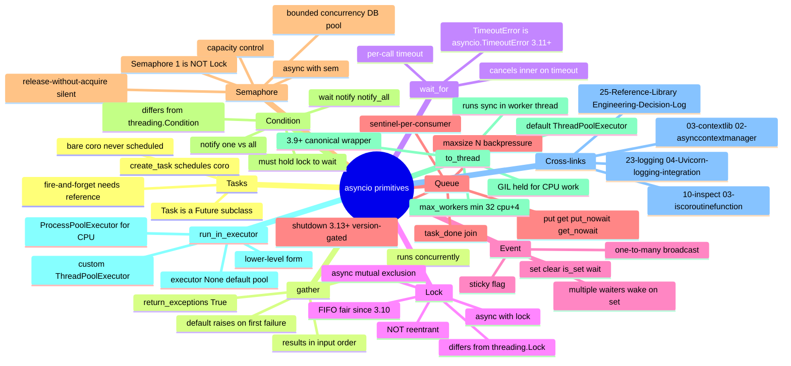

# asyncio primitives — Section Map of Content

*The `Task`, `gather`, `wait_for`, `Lock`, `Event`, `Queue`, `Semaphore`, `Condition`, and `to_thread` primitives — the concurrency toolkit FastAPI's event loop is built on.*

**You're at the very beginning of Section 21.**

`asyncio` is the standard library's concurrency runtime — the event loop that FastAPI runs on, the primitives that let coroutines co-ordinate, and the bridges (`to_thread`, `run_in_executor`) that connect async code to the blocking sync world. This section covers the *primitives* — the things you reach for when you have N coroutines that need to share state, limit concurrency, signal each other, or offload blocking work. By the end you will know `asyncio.create_task` (the only way to actually schedule a coroutine on the loop — the bare `coro()` form is *never* scheduled), `asyncio.gather` / `asyncio.wait_for` (the two combinators — concurrent collection and per-call timeout), `asyncio.Lock` / `asyncio.Event` (mutual exclusion and one-to-many broadcast), `asyncio.Queue` (the producer-consumer channel, with the 3.13+ `shutdown` method version-gated because the 3.12 runtime does not have it), `asyncio.Semaphore` / `asyncio.Condition` (capacity control and wait/notify), and `asyncio.to_thread` (the canonical 3.9+ way to call blocking sync code from async). Take your time. Type every example. **This is how you learn.**

#asyncio #moc #foundation

## Why this section exists

Every FastAPI request handler is an async function. Every async function runs on an event loop. Every event loop is one thread. The moment you have two handlers that need to share state (a cache, a counter, a connection pool), or one handler that needs to call a blocking sync library (the legacy `requests`-based service you have not yet migrated), or a background job queue that needs N worker tasks pulling from a shared queue — you need the asyncio primitives. Without `asyncio.Lock` you have a race condition; without `asyncio.Queue` you have a stampede; without `asyncio.to_thread` you have a frozen loop. The five lessons in this section cover the eight primitives that solve these problems, with the `boardly` project-management API as the running example throughout.

The single most common bug in production asyncio code is the bare-coroutine call — `fetch_project(slug)` (with parens, no `await`, no `create_task`) inside an `async def`, which never runs and emits a `RuntimeWarning: coroutine was never awaited` to stderr six minutes after the user has filed a bug. Lesson 01 is the canonical lesson for that bug and the `create_task` / `gather` / `wait_for` trio that fixes it. The other lessons build on it: `Lock` and `Event` for co-ordination, `Queue` for producer-consumer pipelines, `Semaphore` and `Condition` for capacity control and wait/notify, `to_thread` for the blocking-sync-code bridge. The whole section is the asyncio concurrency toolkit, with version-gates where the runtime differs (the 3.13+ `Queue.shutdown()` is the only 3.13-only feature; everything else is 3.9+ or 3.7+).

## The lessons

| # | Lesson | One-sentence summary |
|---|--------|----------------------|
| 01 | [[21-asyncio-primitives/01-Task-gather-wait_for]] | `asyncio.create_task(coro())` schedules the coroutine on the running loop and returns a `Task` (the bare `coro()` form is never scheduled and emits `RuntimeWarning: coroutine was never awaited`); `asyncio.gather(*coros, return_exceptions=False)` runs them concurrently and returns results in input order; `asyncio.wait_for(aw, timeout)` raises `TimeoutError` (which is `asyncio.TimeoutError` itself in 3.11+, identical in 3.12) on timeout. **Canonical**. |
| 02 | [[21-asyncio-primitives/02-Lock-and-Event]] | `asyncio.Lock()` for async mutual exclusion (`async with lock:`), `asyncio.Event()` for one-to-many wake-ups (`set`/`clear`/`is_set`/`await wait`), the FIFO fairness guarantee (3.10+), and the difference from `threading.Lock` (the asyncio Lock is not reentrant — re-acquiring from the same task deadlocks — and is awaitable, not blocking). |
| 03 | [[21-asyncio-primitives/03-Queue-and-Queue-Shutdown]] | `asyncio.Queue(maxsize=N)` for bounded producer-consumer pipelines (`maxsize=0` is unbounded; `put` blocks when full); `put`/`get`/`put_nowait`/`get_nowait`/`task_done`/`await join`; the sentinel-per-consumer pattern; and the **3.13+** `Queue.shutdown()` method (version-gated; not in 3.12 runtime) that immediately closes the queue and makes pending `get()` raise `QueueShutDown`. |
| 04 | [[21-asyncio-primitives/04-Semaphore-and-Condition]] | `asyncio.Semaphore(value=N)` for capacity control (`async with sem:` limits concurrency to N — the DB pool pattern); `asyncio.Condition()` for the wait/notify pattern (`async with cond: await cond.wait()`, `notify(n=1)`, `notify_all()`); and the trap that `Semaphore(1)` is *not* a substitute for `Lock` (release-without-acquire silently increments the counter on a Semaphore; raises `RuntimeError` on a Lock). |
| 05 | [[21-asyncio-primitives/05-to_thread-and-run-in-executor]] | `asyncio.to_thread(func, *args, **kwargs)` (3.9+) is the canonical way to call blocking sync code from async — `requests.get`, `time.sleep`, file I/O on a slow disk; `loop.run_in_executor(executor, func, *args)` is the lower-level form; the rule "don't call `requests.get` in async — use `to_thread` or `httpx.AsyncClient`"; and the default `ThreadPoolExecutor` formula `max_workers = min(32, os.cpu_count() + 4)` since 3.8. |

## Mindmap

## Reading order

Read the lessons in numbered order. Lesson 01 is the canonical foundation — `create_task` / `gather` / `wait_for` are the primitives every other lesson assumes you can use (you cannot co-ordinate N tasks until you can run N tasks). Lessons 02–04 are the co-ordination primitives, in order of increasing power: `Lock`/`Event` (lesson 02) are the simplest; `Queue` (lesson 03) is the producer-consumer pattern; `Semaphore`/`Condition` (lesson 04) are the capacity-control and wait/notify primitives. Lesson 05 is the bridge to the sync world — `to_thread` and `run_in_executor` — and is independent enough that you can read it out of order if your immediate need is "I have `requests.get` in my async handler and the loop is freezing".

If you only have time for one lesson, read lesson 01. It is enough to stop the bare-coroutine bug and the sequential-fetch-is-slow bug; the other lessons are refinements for specific co-ordination problems.

If you have time for two, read 01 and 05 — you will know how to run N coroutines concurrently and how to call blocking sync code without freezing the loop. That is the minimum asyncio competence for FastAPI development.

## Concepts first-taught in this section

These concepts have their canonical lesson in `21-asyncio-primitives/`:

- **`asyncio.create_task` and the fire-and-forget pattern** → [[21-asyncio-primitives/01-Task-gather-wait_for]] — the canonical lesson for scheduling a coroutine on the loop, the bare-coroutine bug, and the `gather` / `wait_for` combinators.
- **`asyncio.Lock` and `asyncio.Event`** → [[21-asyncio-primitives/02-Lock-and-Event]] — the canonical lesson for async mutual exclusion and one-to-many broadcast, including the FIFO fairness guarantee and the not-reentrant rule.
- **`asyncio.Queue` and the producer-consumer pattern** → [[21-asyncio-primitives/03-Queue-and-Queue-Shutdown]] — the canonical lesson for the bounded async channel, the `task_done` / `join` protocol, and the 3.13+ `shutdown` method (version-gated).
- **`asyncio.Semaphore` and `asyncio.Condition`** → [[21-asyncio-primitives/04-Semaphore-and-Condition]] — the canonical lesson for capacity control and the wait/notify pattern, including the `Semaphore(1)`-is-not-a-`Lock` trap.
- **`asyncio.to_thread` and `loop.run_in_executor`** → [[21-asyncio-primitives/05-to_thread-and-run-in-executor]] — the canonical lesson for the blocking-sync-code bridge and the default `ThreadPoolExecutor` formula.

## Prerequisites

- **The `async with` protocol** — [[03-contextlib/02-asynccontextmanager]]. Every `asyncio.Lock`, `Semaphore`, and `Condition` is used via `async with`; the protocol is `await x.__aenter__()` / `await x.__aexit__(*exc_info)`, identical to `@asynccontextmanager`-wrapped functions. You should be comfortable with the protocol before this section.
- **Coroutine inspection** — [[10-inspect/03-iscoroutinefunction]]. The `iscoroutinefunction` check (and the 3.12 fix that makes it work on `functools.partial`-wrapped coroutines) is what FastAPI uses internally to detect async dependencies; the same machinery is what `gather` and `create_task` use to distinguish coroutines from regular callables.
- **About 2–3 hours of focused time across the five lessons.**

## What you will be able to do by the end

- Schedule a coroutine with `asyncio.create_task(coro())` and explain why a bare `coro()` is never scheduled (the `RuntimeWarning` symptom).
- Run N coroutines concurrently with `asyncio.gather(*tasks)` and explain the input-order result preservation and the `return_exceptions=True` opt-in.
- Enforce a per-call deadline with `asyncio.wait_for(aw, timeout)` and catch `TimeoutError` (which is `asyncio.TimeoutError` itself in 3.12).
- Use `asyncio.Lock` for async mutual exclusion via `async with lock:`, explain the FIFO fairness guarantee (3.10+), and avoid the not-reentrant deadlock trap.
- Use `asyncio.Event` for one-to-many broadcast via `set`/`clear`/`await wait`.
- Use `asyncio.Queue(maxsize=N)` for the producer-consumer pattern, including the `task_done` / `await join` protocol and the sentinel-per-consumer shutdown pattern.
- Version-gate the 3.13+ `Queue.shutdown()` correctly on the 3.12 runtime (where it does not exist).
- Use `asyncio.Semaphore(value=N)` for bounded concurrency (a DB pool of N connections) and explain why `Semaphore(1)` is *not* a substitute for `Lock`.
- Use `asyncio.Condition` for the wait/notify pattern, including the lock-holding requirement for `wait()` and the `notify(n=1)` / `notify_all()` choice.
- Use `asyncio.to_thread(func, *args, **kwargs)` to call blocking sync code from async without freezing the loop, and explain the difference from `loop.run_in_executor` (the lower-level form).
- State the "don't call `requests.get` in async" rule and name both fixes (`to_thread` for migration, `httpx.AsyncClient` for the long term).
- State the default `ThreadPoolExecutor` formula (`max_workers = min(32, os.cpu_count() + 4)` since 3.8) and explain the 32 cap.
- Distinguish I/O-bound blocking (releases the GIL — `to_thread` works) from CPU-bound work (holds the GIL — needs `ProcessPoolExecutor`).

## What's next

When you finish this section, the natural next stops are [[23-logging/04-Uvicorn-logging-integration]] (how FastAPI's logging integrates with Uvicorn's process model — the asyncio loop is per-process, and the logging integration has to know about thread/loop boundaries) and [[25-Reference-Library/Engineering-Decision-Log]] (the canonical place where boardly records "we use `to_thread` for the legacy `requests` calls; we will migrate to `httpx.AsyncClient` in the next sprint" — the long-term memory of the project's engineering commitments).

For the FastAPI arc, the most relevant cross-link is [[03-contextlib/02-asynccontextmanager]] — the `async with` protocol that every primitive in this section exposes. Every `asyncio.Lock`, `Semaphore`, and `Condition` is `async with`-able, just as every `@asynccontextmanager`-decorated function is. The protocol is the same surface area; the lesson there leaves you ready for the primitives here.

Open [[21-asyncio-primitives/01-Task-gather-wait_for]] to begin.

**Welcome to asyncio primitives. We'll see you at the end.**

## Sources

- **`asyncio` — Tasks and Coroutines** — https://docs.python.org/3.12/library/asyncio-task.html — accessed 2026-10-23 — the canonical reference for `create_task`, `gather`, `wait_for`, `to_thread`, and the `RuntimeWarning: coroutine was never awaited` warning.
- **`asyncio` — Synchronization Primitives** — https://docs.python.org/3.12/library/asyncio-sync.html — accessed 2026-10-23 — the canonical reference for `Lock`, `Event`, `Semaphore`, `Condition`, and the FIFO fairness guarantee (3.10+).
- **`asyncio` — Queues** — https://docs.python.org/3.12/library/asyncio-queue.html — accessed 2026-10-23 — the canonical reference for `Queue`, `put`/`get`/`put_nowait`/`get_nowait`, `task_done`, `join`, `QueueFull`, `QueueEmpty`. The 3.13+ `Queue.shutdown` reference is at https://docs.python.org/3.13/library/asyncio-queue.html#asyncio.Queue.shutdown — accessed 2026-10-23 — version-gated; not in the 3.12 runtime.
- **`asyncio` — Event Loop** — https://docs.python.org/3.12/library/asyncio-eventloop.html#asyncio.loop.run_in_executor — accessed 2026-10-23 — the lower-level `run_in_executor` reference, including `executor=None` default behaviour.
- **`concurrent.futures.ThreadPoolExecutor`** — https://docs.python.org/3.12/library/concurrent.futures.html#threadpoolexecutor — accessed 2026-10-23 — the executor class; documents the `max_workers = min(32, os.cpu_count() + 4)` default formula (since 3.8) and the `shutdown(wait=True)` behaviour on `__exit__`.
- **PEP 530 — Asynchronous Comprehensions** — https://peps.python.org/pep-0530/ — accessed 2026-10-23 — the PEP that allows `await` inside list comprehensions (used in the gather pattern in lesson 01).
- **PEP 492 — Coroutines with async and await syntax** — https://peps.python.org/pep-0492/ — accessed 2026-10-23 — the original `async`/`await` PEP; explains why a bare `coro()` is not scheduled.
